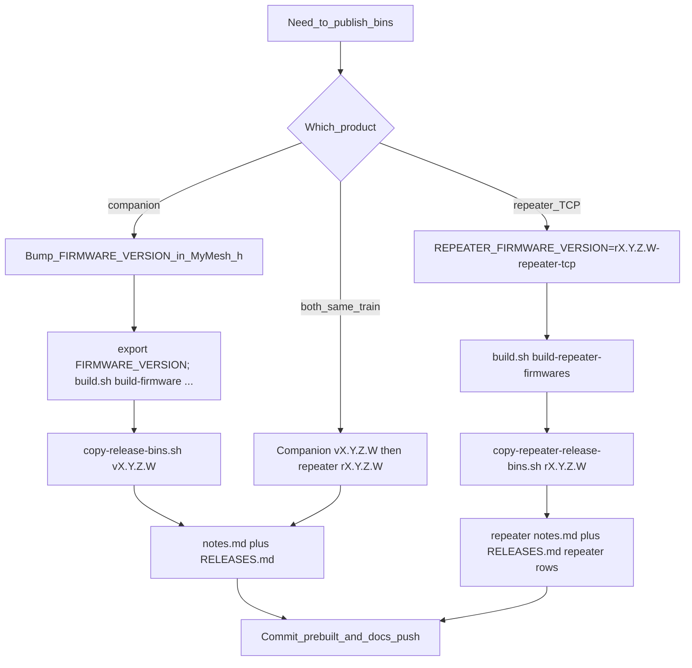

# AGENTS.md — Autonomous Agent Engineering & Release Playbook (`meshcomod`)

Use this file as the **canonical engineering and operational entrypoint** for autonomous AI coding agents working in **`TinkeringDao/meshcomod`**. Always read this document alongside [`docs/agents/autonomous-pipeline.md`](docs/agents/autonomous-pipeline.md), [`docs/agents/domain.md`](docs/agents/domain.md), [`LEGAL.md`](LEGAL.md), and [`SECURITY.md`](SECURITY.md) before modifying any file.

---

## Fully Autonomous Development Pipeline

All changes in `TinkeringDao/meshcomod` follow the **6-Stage Autonomous Development Pipeline** specified in [`docs/agents/autonomous-pipeline.md`](docs/agents/autonomous-pipeline.md) and enforced by [`.github/workflows/autonomous-pr-review.yml`](.github/workflows/autonomous-pr-review.yml):

1. **Stage 1 — Context & Hindsight Recall**: Query `POST http://192.168.10.238:9100/v1/default/banks/satori/memories/recall` and review `AGENTS.md`, `LEGAL.md`, `SECURITY.md`, and `docs/agents/domain.md`.
2. **Stage 2 — Branch Isolation & Signed TDD Implementation**: Branch from `origin/main` (`feat/*`, `fix/*`, `chore/*`, `docs/*`). Author all commits as `TinkeringDao <203040288+TinkeringDao@users.noreply.github.com>` with ED25519 SSH commit signing enabled (`git config commit.gpgsign true`).
3. **Stage 3 — Pull Request Creation**: Open a PR against `main` containing `## Summary`, `## Evidence`, and `## Merge Danger` (`Door: two-way | one-way`, `Blast Radius: local | module | system`).
4. **Stage 4 — Dual GitHub PR Review**:
   - **Automated CI Gate** ([`.github/workflows/autonomous-pr-review.yml`](.github/workflows/autonomous-pr-review.yml)): Verifies OPSEC/Zero-PII on changed files, SSH commit signatures on all PR commits, 8-pillar `LEGAL.md` + German Statutory Addendum & governance file integrity, and `platformio.ini` configuration integrity.
   - **Independent Agentic Spec/Code/Security Review**: Audits `gh pr diff` for architectural, RF/PMIC hardware safety, and legal compliance and posts a structured review via `gh pr review --comment`.
5. **Stage 5 — Autonomous Remediation Loop**: Remediate any review finding or CI failure in a signed commit on the PR branch and post a remediation summary comment.
6. **Stage 6 — Automated Approval, Squash Merge & Hindsight Retention**: `github-actions[bot]` approves the PR (`gh pr review --approve`), satisfying `Protect main branch` (`required_approving_review_count: 1`, `require_last_push_approval: true`), followed by `gh pr merge --squash --delete-branch` and Hindsight memory retention.

---

## Target Board / Variant Architecture & Build Commands

`meshcomod` is the multi-transport (`USB` + `BLE` + `TCP :5000` + `WebSocket :8765`) MeshCore firmware and core library (`core-*` tags consumed by [`TinkeringDao/wadamesh`](https://github.com/TinkeringDao/wadamesh) for touch boards such as `T-Deck`, `Heltec V4 TFT`, `ThinkNode M9`, and `Tanmatsu`).

| Target Board / Variant | MCU | Radio / PMIC | PlatformIO Build Environment |
|---|---|---|---|
| **Heltec WiFi LoRa 32 V4** | ESP32-S3 | `SX1262` + Front-End PA | `pio run -e heltec_v4_companion_radio_usb_tcp` |
| **Heltec WiFi LoRa 32 V4 + TFT** | ESP32-S3 | `SX1262` + Front-End PA | `pio run -e heltec_v4_tft_companion_radio_usb_tcp_touch` |
| **Heltec WiFi LoRa 32 V3** | ESP32-S3 | `SX1262` | `pio run -e Heltec_v3_companion_radio_usb_tcp` |
| **Heltec Wireless Paper** | ESP32-S3 | `SX1262` | `pio run -e Heltec_Wireless_Paper_companion_radio_usb_tcp` |
| **Seeed Xiao S3 WIO** | ESP32-S3 | `SX1262` | `pio run -e Xiao_S3_WIO_companion_radio_usb_tcp` |
| **Elecrow ThinkNode M9** | nRF52840 / ESP32 | `SX1262` / `LR1110` | `variants/thinknode_m9` (companion & touch support) |
| **LilyGo T-Deck / T-Lora Pager / Tanmatsu** | ESP32-S3 / P4 | `SX1262` / `LR1121` + `AXP2101` / `BQ25896` | Core library consumed via `lib_deps` in `wadamesh` + `variants/` |
| **Native Unit Tests** | Host (`native`) | Simulated / KISS Modem | `pio test -e native -e native_kiss_modem -vv` |

---

## Hardware, RF Regulatory & Legal Invariants

1. **RF Regulatory & ERP/Duty-Cycle Boundaries (`Directive 2014/53/EU (RED)`, `ETSI EN 300 220-1/-2`, `ETSI EN 300 328`, `FCC 47 C.F.R. Part 15.247 / Part 97`)**:
   - Sub-GHz LoRa radio configurations (`SX1262`, `LR1110`, `SX1276`) and board-level external PA/FEM stages (`Heltec V4`, `Station G2`) MUST respect regional frequency, conducted power (`dBm`), antenna gain (`dBi`), and duty-cycle limits (`<= 1%` in `868.0–868.6 MHz` SRD `g1`; `<= 10%` in `869.400–869.650 MHz` SRD `g3`).
   - Cryptographic encryption is strictly prohibited on Amateur Radio frequencies (`ITU Radio Regulations Art. 25.2A`, `47 C.F.R. § 97.113(a)(4)`, `§ 16 Abs. 1 Nr. 4 AFuV`).
2. **PMIC & Lithium-Ion Battery Safety (`AXP2101`, `AXP192`, `BQ25896`, `INA3221`)**:
   - Never raise charge termination voltage above `4.20–4.288 V` or disable NTC thermal protection (`0–45 °C`).
3. **Clean-Room Interoperability & Licensing (`MIT`)**:
   - All `meshcomod` source code is licensed under the `MIT` License ([`LICENSE`](LICENSE)); preserve upstream MeshCore copyright headers and third-party notices.
   - Maintain 100% clean-room provenance (`Directive 2009/24/EC`, `Directive (EU) 2016/943`, `17 U.S.C. § 1201(f)`) and nominative fair use of hardware trademarks (`Article 14(1)(c) EUTMR`, `15 U.S.C. § 1115(b)(4)`).
4. **Zero-PII & OPSEC Hygiene**:
   - Never commit personal names, private email addresses, home locations, GPS coordinates, Wi-Fi SSIDs/passwords, or secret tokens.
   - Keep all primary documentation in clean English while preserving `## Addendum: German Statutory References (Applicable to Residents of Germany)` in [`LEGAL.md`](LEGAL.md).

### Pre-Merge Verification & RF Safety Gate Checklist

| Gate | Requirement | Verification Standard |
|---|---|---|
| **1. OPSEC & Zero-PII** | Zero personal identifiers, local paths, Wi-Fi credentials, or tokens in diff | Automated Gate 1 in `.github/workflows/autonomous-pr-review.yml` |
| **2. Signed Commits** | All commits authored by `TinkeringDao <203040288+TinkeringDao@users.noreply.github.com>` with ED25519 SSH signature (`-S -s`) | Automated Gate 2 (`gpgsig` verification) |
| **3. RF ERP & Duty Cycle** | `SX1262` / `LR1110` / `SX1276` & external PA/FEM configs respect `<= 1%` (`g1`) / `<= 10%` (`g3`) duty cycle & ERP limits (`ETSI EN 300 220-1/-2`, `Directive 2014/53/EU`, `FCC Part 15.247`) | Variant & radio preset audit (`variants/`, `LEGAL.md`) |
| **4. PMIC & Battery Safety** | `AXP2101` / `AXP192` / `BQ25896` charge termination `<= 4.20–4.288 V` and `0–45 °C` NTC thermal protection preserved | Driver & board variant review (`variants/`) |
| **5. Clean-Room & Legal** | `MIT` headers intact; `LEGAL.md` retains `Addendum: German Statutory References` | Automated Gate 3 & Stage 4B Agentic Review |

---

## Prebuilt Firmware Release Playbook (`prebuilt/` on `main`)

Human-oriented detail lives in [`docs/RELEASE_PROCEDURE.md`](docs/RELEASE_PROCEDURE.md), [`docs/REPEATER_RELEASE_PROCEDURE.md`](docs/REPEATER_RELEASE_PROCEDURE.md), and [`prebuilt/README.md`](prebuilt/README.md).

### Release Invariants

1. **Immutable version folders:** Never replace binaries inside an existing **`prebuilt/releases/companion/v*…/`**, **`prebuilt/releases/repeater/r*…/`**, or **`prebuilt/releases/rooms/r*…/`** tree to mean "the same release." Cut a **new** version id for any new drop.
2. **Independent "latest" tracks:** **`scripts/copy-release-bins.sh`** (companion), **`scripts/copy-repeater-release-bins.sh`** (TCP repeater), and **`scripts/copy-room-release-bins.sh`** (room multitransport) each update **their own** stable names under **`prebuilt/`**. Running one does **not** change the others' latest files.
3. **Working directory:** All commands below assume **`cd`** to the **MeshCore** repo root (the directory that contains **`build.sh`** and **`scripts/`**).
4. **Use `build.sh`:** Do not promote ad-hoc **`pio run`** outputs unless filenames match what the copy scripts expect (see [`prebuilt/README.md`](prebuilt/README.md)).

### Decision Tree

| Goal | Do this |
|------|---------|
| **Companion-only release** | Bump **`FIRMWARE_VERSION`** in **`examples/companion_radio/MyMesh.h`** → build companion envs → **`copy-release-bins.sh`** → **`prebuilt/releases/companion/v*…/notes.md`** + **`RELEASES.md`** → commit & push. **Skip** repeater build and **`copy-repeater-release-bins.sh`**. Repeater **`prebuilt/*.bin`** and **`prebuilt/releases/repeater/`** are unchanged. |
| **Repeater TCP–only release** | Set **`REPEATER_FIRMWARE_VERSION=rX.Y.Z.W-repeater-tcp`** (recommended; legacy **`vX.Y.Z.W-repeater-tcp`** still globs) → **`build.sh build-repeater-firmwares`** → **`copy-repeater-release-bins.sh rX.Y.Z.W`**. **Do not** set **`FIRMWARE_VERSION`** for repeater-only work. Update **`prebuilt/releases/repeater/r*…/notes.md`** / **`RELEASES.md`**. Companion **`prebuilt/*companion*.bin`** are unchanged unless you also run companion copy. |
| **Same train: companion + repeater** | Use matching numeric trains: **`vX.Y.Z.W`** (companion) and **`rX.Y.Z.W`** (repeater). Run **companion** first (**`copy-release-bins.sh vX.Y.Z.W`**, **`copy-heltec-v4-meshcomod-extras.sh vX.Y.Z.W`**), then **repeater** (**`REPEATER_FIRMWARE_VERSION=…-repeater-tcp`**, **`build-repeater-firmwares`**, **`copy-repeater-release-bins.sh rX.Y.Z.W`** or legacy **`vX.Y.Z.W`**). Destinations: **`prebuilt/releases/companion/vX.Y.Z.W/`** and **`prebuilt/releases/repeater/rX.Y.Z.W/`**. |
| **Room multitransport only** | Set **`ROOM_FIRMWARE_VERSION=rX.Y.Z.W-room-mt`** → **`sh build.sh build-room-multitransport-firmwares`** → **`sh scripts/copy-room-release-bins.sh rX.Y.Z.W`**. Update **`prebuilt/releases/rooms/rX.Y.Z.W/notes.md`** / **`RELEASES.md`** if you document the drop. Companion and repeater **`prebuilt/`** trees are unchanged unless you also run those copy scripts. |

### Commands (Copy-Paste Templates)

#### Companion (USB+TCP meshcomod radio)

```bash
cd /path/to/MeshCore
# 1. Edit examples/companion_radio/MyMesh.h → FIRMWARE_VERSION "vX.Y.Z.W"
export FIRMWARE_VERSION=vX.Y.Z.W
export DISABLE_DEBUG=1   # recommended for release

sh build.sh build-firmware heltec_v4_companion_radio_usb_tcp
sh build.sh build-firmware Heltec_v3_companion_radio_usb_tcp
sh build.sh build-firmware heltec_v4_tft_companion_radio_usb_tcp_touch
sh build.sh build-firmware Heltec_Wireless_Paper_companion_radio_usb_tcp

sh scripts/copy-release-bins.sh vX.Y.Z.W
```

#### Repeater TCP (Wi-Fi companion subset)

```bash
cd /path/to/MeshCore
export REPEATER_FIRMWARE_VERSION=rX.Y.Z.W-repeater-tcp
export DISABLE_DEBUG=1
sh build.sh build-repeater-firmwares
sh scripts/copy-repeater-release-bins.sh rX.Y.Z.W
```

#### Optional: Heltec V4 extras (see prebuilt README)

```bash
sh scripts/copy-heltec-v4-meshcomod-extras.sh vX.Y.Z.W
```

### Flow Diagram


